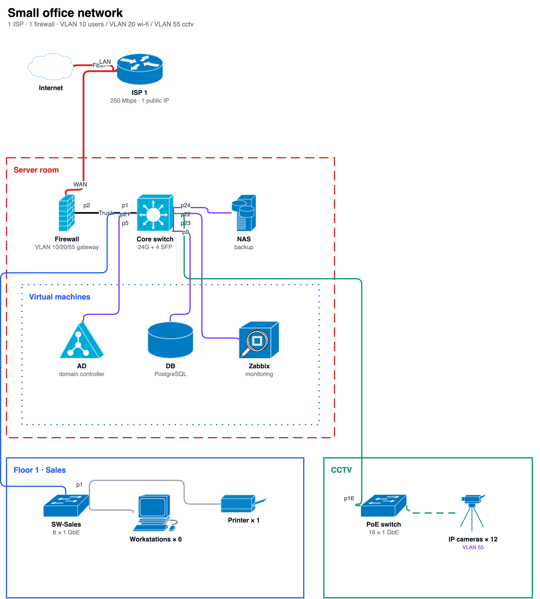
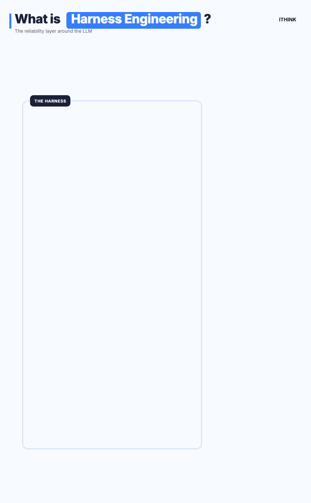

# ithink-skills

Skills for [Claude](https://claude.ai) — each top-level folder is one skill, ready
to drop into `~/.claude/skills/` or upload to claude.ai.

## Skills

| Skill | What it does |
|---|---|
| [**topology-creator**](topology-creator) | Turns a described network into an editable **draw.io** diagram — Cisco icons, zone boxes, interface labels on both ends of every link, colour-coded VLANs, obstacle-avoiding link routing, and a generated legend page. |
| [**system-diagram**](system-diagram) | Turns a described system into an explanatory diagram — vertical flow, zone frame, sidecars for what watches or constrains it, feedback loops routed clear of the column. Emits a self-contained **SVG**, a looping animated SVG, and a real **GIF**. |
| [**ithink-documents**](ithink-documents) | Writes client-facing ITHINK documents — commercial offers, presentations, technical proposals, one-pagers — on the fixed brand system, then inlines Inter and the logos so the result publishes as an artifact and prints to A4 PDF. |





## Install

### Claude Desktop, web and mobile

Download a skill's `.zip` from the
[latest release](https://github.com/shkholikov/ithink-skills/releases/latest)
and upload it at **Settings → Capabilities → Skills**. Nothing to clone, no
terminal needed.

Step-by-step guides for colleagues, with troubleshooting:
**[O'zbekcha](INSTALL.uz.md)** · **[Русский](INSTALL.ru.md)**

### Claude Code

```bash
git clone https://github.com/shkholikov/ithink-skills
cp -R ithink-skills/topology-creator ~/.claude/skills/
cp -R ithink-skills/ithink-documents ~/.claude/skills/
cp -R ithink-skills/system-diagram  ~/.claude/skills/
```

Restart Claude Code. Each skill folder is self-contained — copy only the ones you
want.

## Releasing

`scripts/package.sh` builds the uploadable zips into `dist/`:

```bash
./scripts/package.sh                  # all skills
./scripts/package.sh system-diagram   # just one
```

Each zip holds the skill folder as its single top-level entry, which is what
claude.ai expects — a zip with `SKILL.md` at the root is rejected. The script
checks this before it finishes, and drops build noise plus topology-creator's
3.9 MB `examples/` gallery, which nothing in its `SKILL.md` reads.

Pushing a tag runs the test suites, builds the zips and publishes a release:

```bash
# all three skills
git tag v1.1.0 && git push origin v1.1.0

# just one skill
git tag system-diagram-v1.1.0 && git push origin system-diagram-v1.1.0
```

## Design rules

Every skill here follows the same constraints, so they all behave the same way
wherever Claude runs them:

- **Stdlib only.** No `pip install`. Skills must run unchanged inside Claude's
  sandbox on Desktop and mobile, where nothing can be installed.
- **Self-contained folder.** Assets live with the skill and are embedded into
  output, so generated files have no missing dependencies.
- **Tested.** Each skill ships a test suite runnable with plain `python3`.
- **Fails loudly on bad input, never on cosmetics.** A wrong device id is a hard
  error; an unrecognised icon degrades to a placeholder and a warning.

## Licence

Code is MIT licensed — see [LICENSE](LICENSE).

Bundled third-party assets are **not** covered by it. `topology-creator` ships
icons derived from the **Cisco Network Topology Icon** library, which remain the
property of Cisco Systems, Inc.; see
[topology-creator/README.md](topology-creator/README.md#licence-and-attribution).
