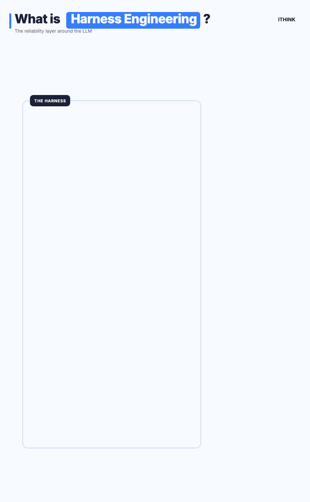

# system-diagram

Turns a described system into a publication-ready diagram: a vertical flow of
stages, a zone frame around the part that matters, sidecar cards for the things
that watch or constrain the flow, and dashed feedback loops routed clear of
everything else.



Three outputs from one spec:

- **`diagram.svg`** — self-contained. Inter and all 98 icons are embedded, so it
  renders identically offline and inside a published artifact under CSP.
- **`diagram.anim.svg`** — the same diagram, alive: icons swing, bob and pulse
  on a shared 2.4s loop and dashed links flow. Pure CSS, no script, and it
  stops for `prefers-reduced-motion`.
- **`diagram.gif`** — a real GIF89a of that loop for chat, Telegram and decks.
  Add `--reveal` instead to build the diagram up one stage at a time.

## Use

```bash
python3 scripts/build_diagram.py examples/harness.json -o diagram.svg
python3 scripts/build_diagram.py examples/harness.json -o diagram.svg --animate
python3 scripts/build_diagram.py examples/harness.json -o diagram.svg --gif
```

The spec is JSON — stages in order, plus what sits beside them:

```json
{
  "title": "What is Harness Engineering?",
  "subtitle": "The reliability layer around the LLM",
  "nodes": [
    {"id": "ctx", "label": "Context Builder", "sub": "live facts + state",
     "step": 1, "tone": "blue",
     "tiles": [{"icon": "file-text", "label": "Docs"},
               {"icon": "database", "label": "Data"}]},
    {"id": "llm", "label": "LLM", "sub": "reasoning", "step": 2,
     "shape": "ellipse", "tone": "violet", "icon": "brain"}
  ],
  "zone":     {"label": "THE HARNESS", "from": "ctx", "to": "llm"},
  "sidecars": [{"id": "obs", "anchor": "llm", "label": "Observability",
                "icon": "activity"}],
  "flow":     [{"from": "ctx", "to": "llm", "label": "grounded input"}],
  "links":    [{"from": "llm", "to": "ctx", "style": "dashed",
                "route": "gutter", "label": "feedback"}]
}
```

Full schema in [`references/spec-schema.md`](references/spec-schema.md), icon
names in [`references/icons.md`](references/icons.md), the colour system in
[`references/palette.md`](references/palette.md).

## How it works

`flow` is the column. `links` is everything else, and that split is the whole
design: things that *observe or constrain* a system are not stages of it, and
putting them in the column is what turns an explanatory diagram into a
confusing one.

A feedback edge takes `"route": "gutter"` and runs up the left channel rather
than across the middle; lanes are assigned automatically so two loops never
share a track.

Overlap is enforced, not hoped for. Boxes claim their space first, links route
as orthogonal paths through the free channels, and every label takes the first
candidate position that touches no box, no line and no other label. Whatever
had to be moved is printed; whatever could not be is named as a warning.

Layout is deliberately one vertical column. A general graph layout engine
produces diagrams nobody can follow; a column reads top to bottom the way the
system it describes actually runs. A diagram that truly needs parallel branches
is the wrong shape for this tool.

## Constraints

Stdlib only. Python ships neither a GIF writer nor a PNG reader, so
`scripts/gifenc.py` contains both — zlib plus five filter types for PNG, LZW
plus a header for GIF89a. Pillow would be one import and would also mean the
skill could not run inside Claude's sandbox.

Rasterising is the one thing the stdlib cannot do, so `--gif` shells out to
headless Chrome for the frames. On a machine without Chrome it exits with a
message and the animated SVG still works.

Text width is approximated rather than measured — no font metrics library — so
check the render before publishing. The failure mode is a word wrapping early,
and it is always visible.

## Tests

```bash
python3 tests/test_system_diagram.py
```

46 tests, no dependencies. They cover spec validation, geometry (nothing
overlaps, the zone encloses its nodes, sidecars stack), SVG well-formedness and
escaping, collision rules (no edge through a node in the shipped example),
frame differencing, and a full LZW round-trip through an independent decoder —
including inputs long enough to force a code-width increase and a dictionary
reset, which is where the encoder was wrong the first time.

## Licence and attribution

Code is MIT, as with the rest of this repo.

Icons are from [Lucide](https://lucide.dev) (ISC), bundled in
`assets/icons.json`; the licence is at `assets/LICENSE-lucide`. Inter is
bundled under the SIL Open Font License.

## Not for network diagrams

Devices, ports, VLANs and cabling belong to
[`topology-creator`](../topology-creator), which produces an editable draw.io
file instead.
